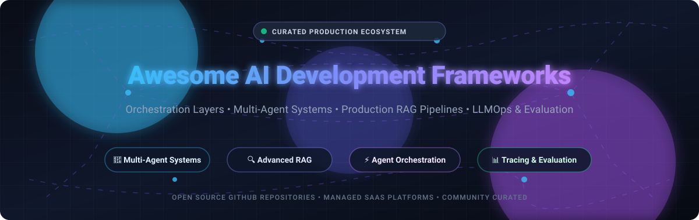

  

# 🚀 Awesome AI Development Frameworks

  
  
  
  
  
  
  

---

## 📖 Overview

A definitive, SEO-optimized curated index of **production-grade AI development frameworks**, **agentic orchestration engines**, **enterprise RAG architectures**, and **LLMOps developer toolkits**. 

Whether you are architecting autonomous multi-agent teams with tool execution, engineering real-time multimodal search pipelines, or building enterprise-ready LLM backends with deterministic structured outputs, this index catalogs the category-defining **SaaS platforms** and **open-source repositories** powering modern artificial intelligence engineering.

---

## 📑 Table of Contents

- [🌐 Sector Overview & Market Dynamics](#-sector-overview--market-dynamics)
- [☁️ SaaS & Hosted AI Development Platforms](#️-saas--hosted-ai-development-platforms)
- [🐙 Open-Source GitHub Frameworks](#-open-source-github-frameworks)
- [🛠️ Framework Selection Matrix](#️-framework-selection-matrix)
- [⭐ Star History](#-star-history)
- [💖 Support & Community](#-support--community)
- [🤝 How to Contribute](#-how-to-contribute)
- [⚖️ Disclaimer](#️-disclaimer)

---

## 🌐 Sector Overview & Market Dynamics

The global **AI Orchestration and LLM Application Development Frameworks market** is estimated at **$3.8 Billion in 2024** and is projected to expand to **$27.5 Billion by 2030**, compounding at a rapid **CAGR of 38.4%**. 

The sector exhibits **moderate to high fragmentation** rather than a winner-take-all monopoly. While hyperscale cloud providers (Microsoft Azure, AWS, Google Cloud) dominate foundational compute infrastructure, developer adoption across the application orchestration tier remains intensely diversified: engineers routinely combine specialized modular frameworks—such as **LangChain** for core harness plumbing, **LlamaIndex** for high-accuracy document parsing and RAG, **CrewAI** or **AutoGen** for multi-agent delegation, and **DSPy** for programmatic prompt compilation—to avoid vendor lock-in and maximize architectural control.

---

## ☁️ SaaS & Hosted AI Development Platforms

The following hosted platforms and managed cloud environments provide turnkey infrastructure, collaborative visual workbenches, automated tracing, and enterprise governance for building and deploying LLM applications.

> Sorted descending by **Company Valuation / Market Capitalization**.

| 🏢 Platform | 🏷️ Company & Valuation / Scale | 💳 Starting Tier Pricing | 🎁 Free Tier / Trial Limits | 🎯 Core Capabilities |
| :--- | :--- | :--- | :--- | :--- |
| **[Azure AI Foundry / AutoGen Studio](https://azure.microsoft.com/en-us/solutions/ai/)** | **Microsoft** `$3.12T Market Cap` *(Rev: $245B+)* | **$0.005 / agent session** *(or $0.096/hr standard pay-as-you-go VM)* | **Azure Free Account**: **$200 credit** (30-day validity) + **12 months** popular free services + **55+ services free forever** | Enterprise multi-agent orchestration, Azure OpenAI integrations, visual agent studio, prompt evaluation, and enterprise-grade compliance. |
| **[Vercel AI Cloud](https://vercel.com/ai)** | **Vercel** `$3.25B Valuation` *(Rev: $100M+ ARR)* | **$20 / user / month** *(Pro Plan; $1.00 per 1M Edge middleware requests)* | **Hobby Plan (Free forever)**: **1 user seat**, **100 GB** bandwidth, **1,000** Edge function executions/month, **100** AI Gateway requests/day | Full-stack TypeScript & React AI development, multi-provider model gateway, streaming UI primitives, and serverless edge deployment. |
| **[Langflow Cloud](https://www.langflow.org/)** | **DataStax** `$1.60B Valuation` *(Rev: $150M+ ARR)* | **$25 / month** *(Serverless Standard; $0.0001 per vector write overage)* | **Astra DB Free Forever Tier**: **$25 monthly credit pool** (~20M read/write operations, **80 GB** vector storage, up to **5 serverless DBs**) | Drag-and-drop visual multi-agent workflow builder, Astra DB vector integration, custom Python components, and native MCP support. |
| **[LangSmith](https://smith.langchain.com/)** | **LangChain Inc.** `$200M Valuation` *(Rev: ~$15M ARR)* | **$39 / seat / month** *(Plus Plan; $2.50 per 1,000 base traces overage)* | **Developer Plan (Free forever)**: **1 user seat**, **5,000 base traces/month**, 14-day data retention, community prompt hub | Production observability, step-by-step agent tracing, LLM cost & token tracking, regression testing suites, and human-in-the-loop annotation. |
| **[LlamaCloud](https://cloud.llamaindex.ai/)** | **LlamaIndex Inc.** `$100M+ Valuation` *(Rev: ~$5M ARR)* | **$50 / month** *(Starter Plan; includes 40,000 credits, $1.25/1k extra)* | **Free Forever Tier**: **10,000 credits/month**, **5 concurrent** parse/extract jobs, **10,000 files / 10 GB** retained document storage | Managed enterprise document parsing (LlamaParse), RAG data pipelines, table and multimodal chunking, and managed vector index sync. |
| **[CrewAI Enterprise](https://www.crewai.com/)** | **CrewAI Inc.** `$100M Valuation` *(Rev: ~$3M ARR)* | **$99 / month** *(Commercial Starter tier; Enterprise pilot from $5,000/mo)* | **Basic Plan (Free forever)**: **50 workflow executions/month**, CrewAI Studio visual canvas, AI workflow copilot, **1 user seat** | Collaborative role-based agent crews, autonomous task delegation, private tool registries, and execution monitoring. |
| **[Dify Cloud](https://dify.ai/)** | **LangGenius Inc.** `$50M Valuation` *(Rev: ~$2M ARR)* | **$59 / workspace / month** *(Professional Plan; 5,000 messages, 3 members, 5GB)* | **Sandbox Plan (Free forever)**: **200 message credits**, **5 AI apps**, **50 documents / 50 MB** knowledge storage, **1 member** | End-to-end agentic workflow studio, visual RAG pipeline builder, model gateway routing, and embeddable WebApp generators. |
| **[Flowise Cloud](https://flowiseai.com/)** | **Flowise AI Inc.** `$20M Valuation` *(Rev: ~$1M ARR)* | **$35 / month** *(Starter Plan; unlimited flows, 10,000 predictions/mo, 1GB)* | **Free Forever Tier**: **2 flows / assistants**, **100 predictions/month**, **5 MB** storage, community forum support | No-code canvas for LangChain & LlamaIndex abstractions, conversational memory nodes, instant REST APIs, and embed widgets. |

---

## 🐙 Open-Source GitHub Frameworks

The most active, highly-starred open-source repositories driving autonomous AI agents, semantic retrieval, and programmatic prompt engineering.

> Sorted descending by **GitHub Star Count**. Click on any star badge to view stargazers.

### 1. 🤖 [AutoGPT](https://github.com/Significant-Gravitas/AutoGPT) 
- **License**: MIT | **Focus**: General Autonomous Agents & Agent Ecosystem
- The pioneering open-source vision for autonomous agent execution. Provides modular agent components, execution benchmarking (agbenchmark), and a visual builder to create autonomous goal-oriented loops that iteratively think, plan, and execute tools.

### 2. ⚡ [Dify](https://github.com/langgenius/dify) 
- **License**: Apache-2.0 (with conditions) | **Focus**: Agentic Workflows & Enterprise LLMOps Platform
- A comprehensive open-source application development platform combining visual prompt engineering, multi-agent workflow choreography, enterprise RAG pipelines, data ingestion, and model management into a single unified self-hosted workspace.

### 3. 🎨 [Langflow](https://github.com/langflow-ai/langflow) 
- **License**: MIT | **Focus**: Visual Multi-Agent & RAG Architecture
- A dynamic, component-driven visual framework for building production agents and complex retrieval pipelines. Features drag-and-drop orchestration, live execution tracing, custom Python component authoring, and Model Context Protocol (MCP) server support.

### 4. 🦜🔗 [LangChain](https://github.com/langchain-ai/langchain) 
- **License**: MIT | **Focus**: Modular Agent Harness & Standard Application Scaffolding
- The industry standard orchestration framework for LLM-powered software. Provides standardized abstractions for chat models, vector stores, prompt templates, tool binding, and middleware, backed by LangGraph for cyclical stateful agent workflows.

### 5. 🏢 [MetaGPT](https://github.com/geekan/MetaGPT) 
- **License**: MIT | **Focus**: Multi-Agent Software Company Simulation
- Multi-agent collaboration framework that models human software organizations. Assigns structured Standard Operating Procedures (SOPs) to simulated product managers, architects, engineers, and QA analysts to generate entire codebases from natural language specs.

### 6. 🛡️ [Strix](https://github.com/usestrix/strix) 
- **License**: Apache-2.0 | **Focus**: Autonomous AI Penetration Testing & Vulnerability Remediation
- An autonomous AI security framework employing a Graph of Agents (GoA) architecture. Features parallel security testing with full hacker toolkits (HTTP proxies, browser automation, Docker runtimes) that validate real exploits with PoCs and generate automated remediation fixes.

### 7. 🤝 [AutoGen](https://github.com/microsoft/autogen) 
- **License**: MIT | **Focus**: Conversational Multi-Agent Orchestration
- Microsoft's flagship multi-agent framework enabling complex multi-turn conversational agents with code execution, nested chats, group chats, and human-in-the-loop controls. Designed for flexible cooperative workflows across autonomous entities.

### 8. 👥 [CrewAI](https://github.com/crewAIInc/crewAI) 
- **License**: MIT | **Focus**: Role-Based Autonomous Agent Collaboration
- High-level multi-agent framework engineered for intuitive role-playing. Define agents with dedicated roles, goals, backstories, memory, and tool sets, and coordinate them sequentially or hierarchically into production task forces.

### 9. 🧩 [Flowise](https://github.com/FlowiseAI/Flowise) 
- **License**: Apache-2.0 | **Focus**: Drag-and-Drop Low-Code LLM App Builder
- Node-based open-source visual interface built with Node.js and TypeScript. Enables developers and business teams to visually wire together LangChain nodes, embedding models, vector stores, and custom webhooks into deployable REST endpoints.

### 10. 🦙 [LlamaIndex](https://github.com/run-llama/llama_index) 
- **License**: MIT | **Focus**: Context Engineering, Data Ingestion & Enterprise RAG
- The premier data framework for connecting custom enterprise data to LLMs. Features 300+ data connectors, advanced chunking algorithms, hierarchical indexing, query engines, and agentic retrieval strategies.

### 11. 🚀 [Agno](https://github.com/agno-agi/agno) 
- **License**: Apache-2.0 | **Focus**: Lightweight Full-Stack Multimodal Agents
- High-performance, lightweight Python framework (formerly Phidata) for building multimodal agents equipped with memory, knowledge, and tools. Optimized for low latency, zero bloat, and enterprise PostgreSQL storage.

### 12. 🔬 [DSPy](https://github.com/stanfordnlp/dspy) 
- **License**: MIT | **Focus**: Programmatic LLM Compilation & Prompt Optimization
- Stanford's academic framework that replaces brittle manual prompt engineering with programming. Deconstructs applications into modular signatures and optimizers (teleprompters) that automatically synthesize and compile optimal prompts and model weights.

### 13. 💬 [ChatDev](https://github.com/OpenBMB/ChatDev) 
- **License**: Apache-2.0 | **Focus**: Virtual Chat-Powered Multi-Agent Software Development
- Multi-agent framework where specialized conversational agents communicate in chat chains to design, code, test, and document software applications from single prompt descriptions.

### 14. 🤗 [smolagents](https://github.com/huggingface/smolagents) 
- **License**: Apache-2.0 | **Focus**: Barebones Python Code-Execution Agents
- Hugging Face's minimalist library where agents formulate actions by writing plain Python code rather than JSON payloads. Highly ergonomic, lightweight, and tightly integrated with the Hugging Face Hub.

### 15. 🧠 [Semantic Kernel](https://github.com/microsoft/semantic-kernel) 
- **License**: MIT | **Focus**: Polyglot Enterprise SDK (C#, Python, Java)
- Microsoft's enterprise orchestration SDK underpinning Copilot. Unifies native code plugins, AI memories, and automated planning into strongly typed contracts across .NET, Python, and Java environments.

### 16. 🔺 [Vercel AI SDK](https://github.com/vercel/ai) 
- **License**: Apache-2.0 | **Focus**: TypeScript Toolkit for Generative UI & Streaming
- The definitive TypeScript/Node.js library for building streaming AI interfaces in Next.js, React, Svelte, and Vue. Features unified provider adapters, tool calling, and structured object generation.

### 17. 🌾 [Haystack](https://github.com/deepset-ai/haystack) 
- **License**: Apache-2.0 | **Focus**: Modular End-to-End Search & RAG Pipelines
- Deepset's production-proven framework for building search and question-answering systems. Features a directed acyclic graph (DAG) pipeline architecture, explicit routing nodes, and modular document stores.

### 18. 💾 [Letta](https://github.com/letta-ai/letta) 
- **License**: Apache-2.0 | **Focus**: Stateful Agents & Long-Term Memory Architecture
- Formerly MemGPT, Letta introduces operating-system-style hierarchical memory tiers (working context vs archival storage) to enable persistent, self-updating agents that preserve identity and knowledge over long horizons.

### 19. 🐝 [OpenAI Swarm](https://github.com/openai/swarm) 
- **License**: MIT | **Focus**: Ergonomic & Educational Multi-Agent Orchestration
- An experimental, lightweight pattern exploration from the OpenAI Solutions team illustrating agent handoffs, isolated routines, and stateless execution flow without heavy runtime dependencies.

### 20. 🛡️ [Pydantic AI](https://github.com/pydantic/pydantic-ai) 
- **License**: MIT | **Focus**: Type-Safe Agent Framework with Dependency Injection
- Developed by the creators of Pydantic. Delivers end-to-end static type validation for agent systems, robust structured outputs, runtime dependency injection, and seamless IDE completions.

### 21. 📐 [Instructor](https://github.com/instructor-ai/instructor) 
- **License**: MIT | **Focus**: Structured LLM Outputs & Schema Validation
- The standard library for extracting structured, validated data from LLMs via function/tool calling. Automatically retries schema mismatches, validates constraints, and pairs seamlessly with Pydantic.

### 22. 🔄 [Prompt Flow](https://github.com/microsoft/promptflow) 
- **License**: MIT | **Focus**: LLM Application Prototyping, Evaluation & CI/CD
- Microsoft's suite of development tools designed to streamline prompt engineering, interactive debugging, quantitative batch evaluation, and deployment of enterprise LLM workflows.

---

## 🛠️ Framework Selection Matrix

| Core Architectural Need | Recommended Open-Source Frameworks | Recommended Managed SaaS |
| :--- | :--- | :--- |
| **Autonomous Multi-Agent Teams** | AutoGen, CrewAI, MetaGPT, ChatDev | CrewAI Enterprise, Azure AI Foundry |
| **Enterprise RAG & Data Indexing** | LlamaIndex, Haystack | LlamaCloud, Langflow Cloud |
| **General Purpose Orchestration** | LangChain, Semantic Kernel, Agno | LangSmith, Azure AI Foundry |
| **Type-Safe / Structured Output** | Pydantic AI, Instructor | Vercel AI Cloud |
| **Code-Writing & Barebones Agents** | smolagents, AutoGPT | CrewAI Studio |
| **Visual / Low-Code Canvas** | Langflow, Flowise, Dify | Dify Cloud, Flowise Cloud |
| **Programmatic Optimization** | DSPy | LangSmith (Evaluations) |
| **Autonomous Security Pentesting** | Strix | Strix Enterprise |
| **Long-Term Stateful Memory** | Letta (MemGPT) | Letta Cloud |

---

## ⭐ Star History

---

## 💖 Support & Community

If you find this curated ecosystem of **AI Development Frameworks** valuable, please consider supporting the project:

- ⭐ **Star this repository** on GitHub to amplify its reach to developers worldwide.
- 🍴 **Fork the project** and submit pull requests with newly launched frameworks and tools.
- 📢 **Share with your team & network** on X/Twitter, LinkedIn, Discord, and Reddit.
- ☕ **Sponsor the Maintainer**: Support continuous research, benchmarking, and updates via the [GitHub Sponsors Dashboard](https://github.com/sponsors/ishandutta2007).

---

## 🤝 How to Contribute

Contributions are warmly welcomed! To suggest a framework or update an existing entry:

1. 🍴 **Fork the repository** to your personal GitHub account.
2. 🌿 **Create a dedicated branch**: `git checkout -b feature/add-new-framework`.
3. 📝 **Add or update the framework** in `README.md` following the established formatting, badges, and objective style.
4. 📬 **Submit a Pull Request** with a concise description of the framework, licensing details, and documentation links.

---

## ⚖️ Disclaimer

- This repository is a **community-curated index** intended for architectural evaluation and research; inclusion does not constitute commercial endorsement.
- All product names, logos, trademarks, and registered trademarks belong to their respective owners.
- When deploying autonomous agents with tool access or production RAG pipelines, ensure rigorous sandbox isolation, least-privilege API key security, and compliance with applicable data privacy regulations (GDPR, CCPA, SOC2).

---

  <b>Built with ❤️ by AI engineers, for AI engineers.</b> 
  Exploring the frontiers of Agent Orchestration, Context Engineering, and Autonomous Systems.

